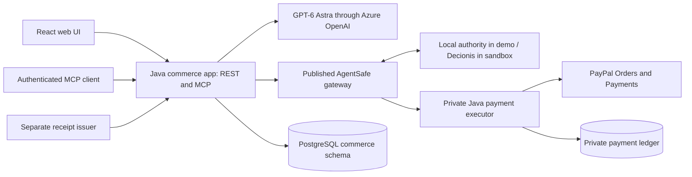

# SwarmPay

**Give agents a budget. Pay merchants only on agreed terms.**

SwarmPay turns an event request into a reviewed plan across two merchants. Tents are paid at checkout; catering is authorized at checkout and captured after an agreed venue receipt passes verification. Every payment command passes through the published AgentSafe gateway and a private Java executor.

Built for the [PayPal AI Hackathon](https://paypalaihackathon.devpost.com/). The architecture was approved on October 25, 2026; see the [approved plan](docs/architecture-and-delivery-plan.md).

**Current delivery:** the demo is live at **[swarm.decionis.com](https://swarm.decionis.com)** with organizer sign-in, Azure OpenAI planning, simulated payments and AgentSafe enforcement against a local test authority. The public browser journey, signed fixture capture, evidence export and AKS isolation checks passed. Java REST/MCP services and persistent workflows also run locally. Native PayPal sandbox and hosted Decionis enforcement validation remain incomplete. See the [capability matrix](docs/implementation-status.md).

**Run the local demo**

Install Docker with Compose v2 and Node.js 22.23.2 (the version in `.node-version`). Java is provided by the Docker build; no host JDK is needed for this path. The initial build downloads dependencies.

```sh
node demo/setup.mjs
node demo/doctor.mjs
docker compose up --build -d --wait
```

Open **[http://localhost:5173](http://localhost:5173)** and choose **Explore the local demo**. The UI and a separate webhook listener on port 5184 bind only to loopback. The setup script generates private local passwords/tokens and a demo venue key; it preserves an existing `.env` and does not configure external accounts. If your `.env` predates the simulated venue, run `node demo/setup.mjs` again: it adds the venue's signing key, which only the venue container receives.

1. Keep the event about an hour ahead, confirm tent rentals, and leave both offer preferences on **Sourcing Agent chooses**. Prepare a plan for 30 guests and five tents.
2. The Sourcing Agent chooses the $500 tent rental and $900 catering, the fullest combination within the $1,500 budget, and the server checks its choice. Approve the $1,400 plan.
3. Complete each **Simulated checkout**. Tents show paid; catering shows authorized and awaiting delivery.
4. Open **Delivery & proof**. A photo alone cannot release catering. Choose **Let the agent request payment**: the milestone agent asks for the catering payment before delivery, and AgentSafe holds the request. No payment command is queued.
5. Choose **Confirm delivery as the venue**. A separate venue container signs a receipt with its own key; SwarmPay verifies that it matches the event, merchant, quantity and delivery window, and the same AgentSafe boundary allows the catering capture. **Download evidence** exports the payment records and application audit chain.

To test altered or replayed receipts, sign an exported workflow with `node demo/sign-receipt.mjs /path/to/workflow.json /path/to/receipt.json` and upload the file within 15 minutes.

The default demo uses synthetic prices, stock, agent responses, venue attestations, authority decisions and payment responses. Azure planning can be enabled independently with `SWARM_AI_PROVIDER=azure`; the UI identifies the source of each assessment. No PayPal charge occurs in demo mode. Quotes last 30 minutes; catering checkout must be within three days of the event. Use a new plan when a quote expires. A longer walkthrough is in [demo/walkthrough.md](demo/walkthrough.md).

Stop with `docker compose down`; the database, authority journal and key volumes remain. A later `docker compose up -d --wait` restores workflows. Removing volumes destroys those records, so volume deletion is not part of the normal reset procedure. Use **New plan** for another demonstration.

**Architecture**



The demo shares one plan and budget but uses **two merchant approvals**. It does not implement legal escrow, platform custody, automatic marketplace splitting, or Standard Payouts. Authorization followed by capture avoids paying the same seller twice through a separate payout.

| Path | Responsibility |
| --- | --- |
| `apps/commerce-app` | Spring Boot REST, authenticated Streamable HTTP MCP, workflow coordinator and worker |
| `apps/payment-executor` | Private Spring Boot service holding PayPal credentials and a durable attempt ledger |
| `apps/web` | React/TypeScript/Vite UI, native PayPal SDK branch, browser tests |
| `modules/commerce-domain` | Typed intents, immutable plans, money in integer cents |
| `modules/agent-workflows` | Bounded sourcing/risk assessments and typed intent extraction through OpenAI Responses |
| `modules/integrations` | PayPal SDK/API, authority HTTP client, catalog and Ed25519 receipt verification |
| `modules/persistence` | Atomic consent/reservations, outbox, attempt ledger and audit chain |
| `modules/mcp-tools` | Seven typed tools; human plan approval is not an agent tool |
| `infra/agentsafe` | Pinned published gateway, synthetic policy and adversarial boundary tests |
| `infra/egress` | The agent's only route out: an HTTPS proxy that admits the configured model host and refuses PayPal |
| `contracts`, `docs`, `demo` | Wire contracts, operating limits, setup and repeatable validation |

Java 21, Spring Boot 4.1.2, Spring AI 2.0.2, Gradle 8.14.3, PayPal Java SDK 2.4.0, and OpenAI Java 4.91.0 are pinned. The requested model is `gpt-6-astra`; there is no model fallback. AgentSafe 0.2.5 and its pipeline 0.3.8 are locked. A reviewed Presence dependency override is explained in [security and reliability](docs/security-and-reliability.md).

**Verify locally**

With Node 22 active, select deterministic AI for the fixture tests without changing `.env`:

```sh
SWARM_AI_PROVIDER=demo docker compose up -d --wait commerce-app
node demo/verify-java.mjs
node --test demo/check-paypal.test.mjs infra/egress/proxy.test.mjs infra/venue/venue.test.mjs infra/azure/render.test.mjs infra/azure/prepare-secrets.test.mjs infra/azure/release.test.mjs
npm --prefix infra/agentsafe ci
npm --prefix infra/agentsafe test
npm --prefix infra/agentsafe run verify-boundary
node demo/smoke.mjs
node demo/check-isolation.mjs
node demo/check-webhook-ingress.mjs
node demo/check-restart.mjs
npm --prefix apps/web ci
npm --prefix apps/web run build
cd apps/web
npx playwright install chromium
npm run test:e2e
```

If Chrome is already installed, `SWARM_TEST_BROWSER=chrome npm run test:e2e` can use it instead of downloading Chromium. Browser tests and smoke tests require synthetic payment and AI configuration. From the repository root, `docker compose up -d --wait commerce-app` restores the provider configured in `.env`. `check-restart.mjs` recreates the three application services and verifies that the smoke-test payment identities survive; run it only against the local test stack. Test artifacts go into ignored `.local/`, `test-results/`, and `playwright-report/` directories.

For native Java development, activate JDK 21 and run `./gradlew verify` (Docker is still needed by Testcontainers). `./gradlew webBuild` runs the pinned frontend build when Node 22 is on `PATH`. With the Compose API running, `npm --prefix apps/web run dev` opens Vite on port 5174.

The [CI workflow](.github/workflows/verify.yml) runs the Java, SDK HTTP protocol, webhook verification, gateway, API/MCP, isolation, callback ingress, restart, deployment configuration, source packaging and browser checks using synthetic fixtures. PayPal/OpenAI/Decionis account tests are deliberately separate.

**Azure hosting**

The demo runs in the user-approved existing `decionis` namespace of `decionis-rg` / `decionis-aks` in Central US. Its resources and policy selectors are dedicated to `swarm-pay`; the deployment does not change shared namespace labels or existing Decionis workloads. Five services are healthy, both volumes are bound, and public HTTPS uses a verified Let's Encrypt certificate. See the [Azure runbook](docs/azure-hosting.md) for the release record, separate credentials, network checks and rollout procedure.

`infra/azure/release.mjs` packages a merged commit directly from Git, requires successful CI for that commit and submits an AMD64 build to the existing Azure registry. It emits deployment image references only after the run and all four registry digests verify. The current deployment uses the [recorded immutable images](infra/azure/releases/d3ea860.images.json); the runbook includes the commands and recovery limits.

Hosted access requires `SWARM_PUBLIC_ORIGIN=https://swarm.decionis.com` and `SWARM_SESSION_COOKIE_SECURE=true`. The app validates Host/Origin, requires organizer sign-in and disables the one-click local demo session. The normal loopback demo keeps both settings at their generated defaults. An isolated HTTPS rehearsal runs without provider credentials or changes to `.env`:

```sh
node demo/hosted/run.mjs up
node demo/hosted/run.mjs check
node demo/hosted/run.mjs down
```

Use `SWARM_TEST_BROWSER=chrome` for the check if Chrome is installed. This separate stack exercises the full simulated payment journey, sign-in/sign-out, origin rejection, secure cookies and restricted container users/filesystems. It does not prove AKS network enforcement or replace native sandbox acceptance.

The separate `demo/check-deployed.mjs` explicitly tests the public Azure demo with normal TLS verification, private organizer credentials and a host-only fixture signing key. It makes two real Azure model calls and one simulated workflow; it is never run by ordinary CI. The completed run verified the photo-only hold, receipt capture, evidence export and desktop/mobile views. Credentials remain in the private deployment bundle, not in this repository.

The supplied hosted AgentSafe choices are recorded in the [hosting runbook](docs/azure-hosting.md#hosted-agentsafe-endpoints): `swarm.decionisedge.com` currently reports an unserved host; `dci.decionisedge.com` requires a tenant key. Neither has been verified as SwarmPay's enforcement gateway, so the demo continues to disclose its local test authority.

**Connect real sandbox accounts**

Follow [sandbox-setup.md](docs/sandbox-setup.md). It covers Azure OpenAI credentials and deployment, two PayPal seller apps plus a sandbox buyer, webhook verification, a Decionis tenant with enforcement access, and a separately identified test venue issuer. Use a separate Compose project and `.env.sandbox` for payment account tests; each database binds itself to its runtime mode and refuses relabeling demo payments as sandbox payments.

`node demo/check-paypal.mjs .env.sandbox --callback-origin https://swarm.decionis.com` checks configured seller OAuth access and webhook subscriptions using PayPal's sandbox API, including the expected host and `/webhooks/paypal/{merchant}` paths. It prints no secrets, sends no payment requests, and writes a private readiness report. Missing account configuration produces a nonzero exit code. The [ngrok runbook](docs/sandbox-setup.md#temporary-ngrok-callbacks) remains an optional callback path for local sandbox testing. The hosted Azure demo currently uses simulated payments; its public availability does not verify native PayPal callbacks.

The [API and MCP reference](contracts/README.md), [security notes](docs/security-and-reliability.md), and [implementation status](docs/implementation-status.md) describe the supported behavior and outstanding integration work. A local file-presence check is not proof that an account or grant can execute.

Apache-2.0; see [LICENSE](LICENSE) and [NOTICE](NOTICE).
