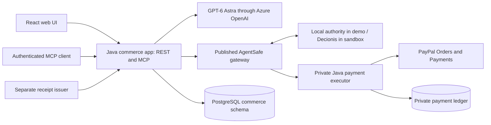

# SwarmPay

**Give agents a budget. Pay merchants only on agreed terms.**

An event organizer must pay several merchants on different terms, and handing an AI agent a card puts the whole budget at risk. With SwarmPay, the organizer describes the event, AI agents build a plan across two merchants, and each merchant is paid only on its agreed terms: tents at checkout, catering after a signed venue receipt confirms delivery. The organizer approves the exact plan once; agents never hold payment credentials.

Built for the [PayPal AI Hackathon](https://paypalaihackathon.devpost.com/).

| | |
| --- | --- |
| **Video** | _TODO: YouTube link_ |
| **Live demo** | [swarm.decionis.com](https://swarm.decionis.com). Describe the event, then **Continue with PayPal** to create your organizer account with a PayPal sandbox buyer. Payments run in the PayPal sandbox with test money; tents to buy come from Channel3 listings, while rentals, catering and the venue are simulated. The sandbox buyer and organizer password logins are in the Devpost private testing instructions. |
| **Run locally** | [Three commands](#run-it-locally), no accounts needed |
| **Your own copy** | [](https://render.com/deploy?repo=https://github.com/ocularminds/swarmpay) with simulated payments, from [`render.yaml`](render.yaml). [What it deploys and costs](docs/render.md) |

## PayPal capabilities

Only a private executor holds the merchants' PayPal credentials; every payment command reaches it through a fail-closed policy gateway (AgentSafe). A separate sign-in service holds only SwarmPay's Log in with PayPal secret.

- **JavaScript SDK Buttons**, with a separate `data-namespace` per merchant so each seller gets its own buyer approval ([`PayPalCheckout.tsx`](apps/web/src/PayPalCheckout.tsx)).
- **Orders v2**: `CAPTURE` intent for tents, `AUTHORIZE` intent for catering, the seller as payee and a `PayPal-Request-Id` on each write.
- **Payments v2**: capture the catering authorization after the receipt verifies, or void it. **Reauthorize** it after PayPal's 3-day honor period, so catering can be booked up to 27 days ahead and still be paid from a fresh authorization, and **refund** the tents capture when the organizer cancels.
- **Webhook signature verification** per seller ([`PayPalWebhookVerifier.java`](modules/integrations/src/main/java/com/swarmpay/integrations/PayPalWebhookVerifier.java)).
- **PayPal Java Server SDK** 2.4.0 for all Orders and Payments calls ([`PayPalPaymentProvider.java`](modules/integrations/src/main/java/com/swarmpay/integrations/PayPalPaymentProvider.java)).

**Verified in the PayPal sandbox on October 28, 2026**, on the live demo:

- Tents: $500 captured at checkout (capture `9JJ483087H808781G`) for the tents seller.
- Catering: $900 authorized (authorization `76F230656E5431143`), held through delivery, then captured after the venue's signed receipt (capture `8LX13782L6474070M`) for the catering seller.
- Before delivery, AgentSafe held the agent's request to pay catering; no payment was queued or sent.
- Replaying the receipt created no second payment: one capture per seller.
- Six PayPal webhook notifications passed signature verification, and both evidence chains verified.

AgentSafe decided these payments with a local test authority, not hosted Decionis, and the catalog and venue are simulated. The tents checkout was created through the application API with buyer approval in PayPal; catering used the PayPal buttons end to end. The [release record](infra/azure/releases/2026-10-28.sandbox.json) lists the deployed images and results.

## AI

Azure OpenAI `gpt-6-astra` through the Responses API ([`modules/agent-workflows`](modules/agent-workflows)):

- **Intent extraction** turns free text into typed, editable fields (guests, tents, budget in cents, venue, weather, date) and clarifying questions.
- **Sourcing** chooses one tent and one catering offer through a schema that admits only the catalog's offer IDs; Java checks capacity, dates and budget before a plan exists.
- **Risk & milestone** review checks the chosen offers against the confirmed event.
- **Tents to buy** come from [Channel3](https://channel3.ai)'s product data when `CHANNEL3_API_KEY` is set: the server searches in-stock tents that leave room in the budget for catering, and the Sourcing Agent may choose only among those, at Channel3's prices. The plan names the product and where it's listed; the PayPal sandbox tents merchant fills the order and is the seller paid. Without a key, tents are rental-only.

Every call uses a strict JSON schema, is revalidated in Java and fails closed, with no model fallback. Agents get no payment tools; catalog prices set the amounts, and the organizer approves every value. An agent can ask for the catering payment through the MCP `request_milestone_payment` tool, but that request goes through AgentSafe, which holds it until a verified delivery receipt exists.

**See every payment.** **Payments** in the workspace opens a spend dashboard on [AG Studio](https://www.ag-grid.com/studio/): paid, held until delivery, refunded and stopped requests, a budget guardrail per plan and AgentSafe's decisions. With Azure OpenAI, ask its agents about it, including SwarmPay's own AgentSafe analyst, which can explain a hold but cannot pay. The **Ledger** tab lists every payment and agent request ([AG Grid](https://www.ag-grid.com/)): search, filter, a total of what was actually paid for the rows shown, and CSV export. Each plan also shows when each merchant is paid on a schedule ([Bryntum Scheduler](https://bryntum.com/products/scheduler/), trial build): tents at checkout, catering held until the venue's delivery window, and any request AgentSafe held.

**Bring your own agent.** In the workspace, **Agents** issues a token for your own MCP client. It acts on your plans only, can never approve one, and can be revoked. The [Postman collection](postman/README.md) plays that agent against SwarmPay's MCP server and checks that AgentSafe holds its early payment request; CI runs it on every change.

## Run it locally

Needs Docker with Compose v2 and Node.js 22. No PayPal or Azure account is required.

```sh
node demo/setup.mjs
node demo/doctor.mjs
docker compose up --build -d --wait
```

Open <http://localhost:5173>, describe your event in the box under the headline (or choose **Use an example**) and choose **Plan my event**. Let the Sourcing Agent choose the offers, approve the $1,400 plan and pay both merchants. Then watch AgentSafe hold the agent's early request to pay catering, and release catering only when the simulated venue confirms delivery with a signed receipt. The [walkthrough](demo/walkthrough.md) has the full script.

## Architecture



One plan and budget, two merchant approvals. Authorize-then-capture pays each seller directly, with no escrow, custody or payouts.

---

## For maintainers

### Local demo details

Use Node.js 22.23.2, the version in `.node-version`. Java is provided by the Docker build; no host JDK is needed for this path, and the initial build downloads dependencies. The UI and a separate webhook listener on port 5184 bind only to loopback. `demo/setup.mjs` generates private local passwords/tokens and a demo venue key; it preserves an existing `.env` and configures no external accounts. If your `.env` predates the simulated venue or PayPal sign-in, run `node demo/setup.mjs` again: it adds the venue's signing key, which only the venue container receives, and the token the app uses to ask the PayPal sign-in service. Sign-up with PayPal stays off until SwarmPay's own PayPal app is configured ([sandbox setup](docs/sandbox-setup.md)).

Each screen offers one next action in its **Next step** card.

1. On the landing, choose **Use an example** and **Plan my event**. The workspace opens with the description already read into editable details. Keep the event about an hour ahead and choose **Rent tents**. Leave the offers to the Sourcing Agent and choose **Prepare my plan** for 30 guests and five tents.
2. The Sourcing Agent chooses the $500 tent rental and $900 catering, the fullest combination within the $1,500 budget, and the server checks its choice. Choose **Approve $1,400**.
3. Choose **Pay $500**, then **Authorize $900**, each in a simulated PayPal checkout. Tents show paid; catering shows authorized and paying on delivery.
4. Under **Try it**, choose **Let the agent ask**: the milestone agent asks for the catering payment before delivery, and AgentSafe holds the request. No payment command is queued. A delivery photo, under **Other ways to confirm**, cannot release catering on its own.
5. Choose **Confirm delivery as the venue**. A separate venue container signs a receipt with its own key; SwarmPay verifies that it matches the event, merchant, quantity and delivery window, and the same AgentSafe boundary allows the catering capture. **Download evidence** exports the payment records and application audit chain.

To test altered or replayed receipts, sign an exported workflow with `node demo/sign-receipt.mjs /path/to/workflow.json /path/to/receipt.json` and upload the file within 15 minutes.

The over-budget path is just as short: with a $1,300 budget the plan shows **Over budget by $100** and offers a new plan, never approval or checkout. Records and authority decisions sit under **What happened**.

The default demo uses synthetic prices, stock, agent responses, venue attestations, authority decisions and payment responses. Azure planning can be enabled independently with `SWARM_AI_PROVIDER=azure`; the UI identifies the source of each assessment. No PayPal charge occurs in demo mode. Quotes last 30 minutes; catering can be authorized up to 27 days before the event, and SwarmPay renews the PayPal hold 3 days before delivery. **Cancel the event**, under **Pause or cancel**, refunds the tents and voids the catering hold before the event starts. Use a new plan when a quote expires.

Stop with `docker compose down`; the database, authority journal and key volumes remain. A later `docker compose up -d --wait` restores workflows. Removing volumes destroys those records, so volume deletion is not part of the normal reset procedure. Use **New plan** for another demonstration.

### Repository layout

| Path | Responsibility |
| --- | --- |
| `apps/commerce-app` | Spring Boot REST, authenticated Streamable HTTP MCP, workflow coordinator and worker |
| `apps/payment-executor` | Private Spring Boot service holding PayPal credentials and a durable attempt ledger |
| `apps/web` | React/TypeScript/Vite UI, native PayPal SDK branch, browser tests |
| `modules/commerce-domain` | Typed intents, immutable plans, money in integer cents |
| `modules/agent-workflows` | Bounded sourcing choice, risk assessment and typed intent extraction through OpenAI Responses |
| `modules/integrations` | PayPal SDK/API, authority HTTP client, catalog and Ed25519 receipt verification |
| `modules/persistence` | Atomic consent/reservations, outbox, attempt ledger and audit chain |
| `modules/mcp-tools` | Seven typed tools; human plan approval is not an agent tool |
| `infra/agentsafe` | Pinned published gateway, synthetic policy and adversarial boundary tests |
| `infra/egress` | The agent's only route out: an HTTPS proxy that admits the configured model host and refuses PayPal |
| `infra/venue` | The simulated venue: the only holder of the venue signing key; signs a receipt for the signed-in organizer's recorded order |
| `infra/identity` | PayPal sign-in: the only holder of SwarmPay's Log in with PayPal secret; returns who signed in, never a token |
| `postman` | The agent's view: a Postman collection that plays an agent over MCP, plus local and live environments |
| `contracts/apimatic` | The OpenAPI 3.1 document APIMatic builds a TypeScript SDK and API docs portal from (`node demo/apimatic.mjs`) |
| `contracts`, `docs`, `demo` | Wire contracts, operating limits, setup and repeatable validation |

Java 21, Spring Boot 4.1.2, Spring AI 2.0.2, Gradle 8.14.3, PayPal Java Server SDK 2.4.0, and OpenAI Java 4.91.0 are pinned. The model is fixed to `gpt-6-astra`; there is no model fallback. AgentSafe 0.2.5 and its pipeline 0.3.8 are locked. A reviewed Presence dependency override is explained in [security and reliability](docs/security-and-reliability.md).

### Verify locally

With Node 22 active, select deterministic AI for the fixture tests without changing `.env`:

```sh
SWARM_AI_PROVIDER=demo docker compose up -d --wait commerce-app
node demo/verify-java.mjs
node --test demo/check-paypal.test.mjs infra/egress/proxy.test.mjs infra/venue/venue.test.mjs infra/azure/render.test.mjs infra/azure/prepare-secrets.test.mjs infra/azure/release.test.mjs
npm --prefix infra/agentsafe ci
npm --prefix infra/agentsafe test
npm --prefix infra/agentsafe run verify-boundary
node demo/smoke.mjs
node demo/check-isolation.mjs
node demo/check-webhook-ingress.mjs
node demo/check-restart.mjs
npm --prefix apps/web ci
npm --prefix apps/web run build
cd apps/web
npx playwright install chromium
npm run test:e2e
```

If Chrome is already installed, `SWARM_TEST_BROWSER=chrome npm run test:e2e` can use it instead of downloading Chromium. Browser tests and smoke tests require synthetic payment and AI configuration. From the repository root, `docker compose up -d --wait commerce-app` restores the provider configured in `.env`. `check-restart.mjs` recreates the three application services and verifies that the smoke-test payment identities survive; run it only against the local test stack. Test artifacts go into ignored `.local/`, `test-results/`, and `playwright-report/` directories.

For native Java development, activate JDK 21 and run `./gradlew verify` (Docker is still needed by Testcontainers). `./gradlew webBuild` runs the pinned frontend build when Node 22 is on `PATH`. With the Compose API running, `npm --prefix apps/web run dev` opens Vite on port 5174.

The [CI workflow](.github/workflows/verify.yml) runs the Java, SDK HTTP protocol, webhook verification, gateway, API/MCP, isolation, callback ingress, restart, deployment configuration, source packaging and browser checks using synthetic fixtures. PayPal/OpenAI/Decionis account tests are deliberately separate.

### Hosted demo

`swarm.decionis.com` runs eight dedicated `swarm-pay-*` deployments in the existing `decionis` namespace of the `decionis-aks` cluster, with real Azure AI, PayPal sandbox payments, sign-up with PayPal through SwarmPay's own sandbox app, the simulated venue and a local test authority. Only the `swarm-pay-identity` service holds the PayPal login secret; the agents still have no route to PayPal. Sandbox payments use their own database and evidence volumes; the earlier simulated-payments records are preserved. Hosted access requires `SWARM_PUBLIC_ORIGIN` and `SWARM_SESSION_COOKIE_SECURE=true`, which enforce Host/Origin checks, organizer sign-in and secure cookies and disable the one-click local session. Details are linked rather than repeated here:

- [Azure hosting runbook](docs/azure-hosting.md): CI-bound image releases, the [latest release record](infra/azure/releases/2026-10-28.sponsor-tools.json) with its immutable images (the [sandbox payments record](infra/azure/releases/2026-10-28.sandbox.json) has the payment run, and the [PayPal sign-in record](infra/azure/releases/2026-10-28.paypal-sign-in.json) the sign-up rollout), network policies, TLS, the local HTTPS rehearsal (`node demo/hosted/run.mjs`), the explicit public acceptance check (`demo/check-deployed.mjs`) and rollback limits.
- [Hosted AgentSafe endpoints](docs/azure-hosting.md#hosted-agentsafe-endpoints): neither candidate Decionis endpoint is verified as SwarmPay's enforcement gateway yet, so the demo discloses its local test authority.
- [Security and reliability](docs/security-and-reliability.md): the authority boundary, payment replay protection, evidence limits and hosted web access rules.

### Connect real sandbox accounts

Follow [sandbox-setup.md](docs/sandbox-setup.md) for Azure OpenAI, two PayPal seller apps plus a sandbox buyer, webhook verification, a Decionis tenant with enforcement access and a separately identified test venue issuer. Payment account tests use a separate Compose project and `.env.sandbox`; each database binds itself to its runtime mode and refuses relabeling demo payments as sandbox payments.

`node demo/check-paypal.mjs .env.sandbox --callback-origin https://swarm.decionis.com` checks seller OAuth access and webhook subscriptions through PayPal's sandbox API, including the expected host and `/webhooks/paypal/{merchant}` paths. It prints no secrets, sends no payment requests and writes a private readiness report. Temporary ngrok callbacks, described in the same runbook, are an optional path for local sandbox testing.

The [API and MCP reference](contracts/README.md), [delivery phases](docs/delivery-phases.md), [architecture plan](docs/architecture-and-delivery-plan.md) and [implementation status](docs/implementation-status.md) describe the supported behavior and outstanding integration work. A local file-presence check is not proof that an account or grant can execute.

Apache-2.0; see [LICENSE](LICENSE) and [NOTICE](NOTICE).
