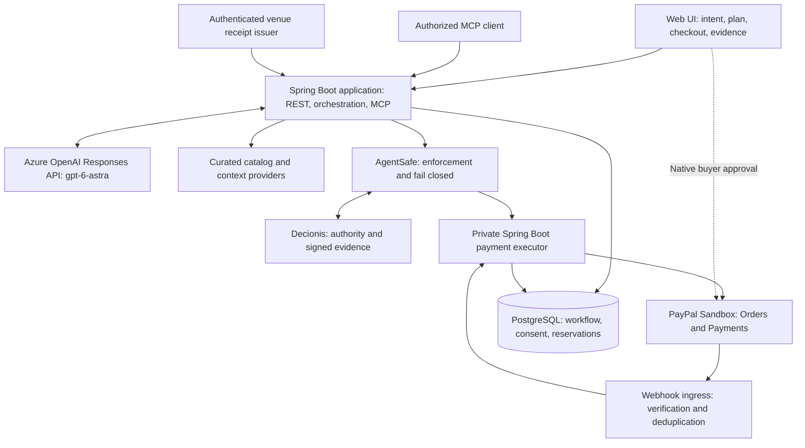

**SwarmPay — architecture and delivery plan**

Status: approved on October 25, 2026. This document records the approved target architecture and delivery gates. The local implementation is now present; see [implementation-status.md](implementation-status.md) for verified behavior and outstanding work. Credentials have since been configured and Azure OpenAI selected as the model provider; its intent and assessment calls have passed. PayPal and hosted Decionis account checks remain outstanding. Schedule estimates below remain planning assumptions for one hands-on engineer with AI coding assistance; team availability is unconfirmed.

My recommendation is to keep the existing **SwarmPay** name and position the product as: **“Give agents a budget. Pay merchants only on agreed terms.”** Use MACE as the original concept name. Describe the implemented payment mechanism as milestone-based payment, rather than escrow.

The strongest hackathon story is an event organizer delegating a purchase across two merchants, seeing an unsafe proposal stopped, and watching a valid delivery trigger a real PayPal sandbox capture with inspectable evidence. The payment and authority boundary should be the central demonstration.

The [official challenge](https://paypalaihackathon.devpost.com/) closes **November 12, 2026 at 12:00 PST / 20:00 UTC / 21:00 Europe/Stockholm**. Its criteria cover technical implementation, design, impact, innovation, and presentation. The [rules](https://paypalaihackathon.devpost.com/rules) require meaningful PayPal sandbox and AI integration, a functional build or hosted demo, a public repository with an open-source license, and a public YouTube demonstration under three minutes. Target submission on November 11.

The brief needs the following corrections before implementation:

| Brief assumption | Verified capability and architectural consequence |
| --- | --- |
| PayPal provides an escrow/holding account through ordinary checkout | The documented choices are authorization followed by capture, or platform delayed disbursement. Neither establishes the proposed general-purpose escrow arrangement. Use accurate product terminology and avoid custodial claims. [Authorization/capture](https://developer.paypal.com/checkout/delay-capture/), [delayed disbursement](https://developer.paypal.com/platforms/checkout/delayed-disbursement/). |
| Multiple purchase units automatically combine arbitrary websites | Multi-seller payments apply to merchants participating in a platform integration. They produce separate merchant transactions; capture can partially succeed. Discovery does not give the platform permission to charge on a seller's behalf. [Multi-seller payments](https://developer.paypal.com/platforms/checkout/standard/customize/multiseller-payments), [platform onboarding](https://developer.paypal.com/platforms/get-started). |
| One multi-seller order can authorize all sellers for later capture | Orders with `intent=AUTHORIZE` cannot contain more than one purchase unit. Separate authorization orders are needed for the baseline. [Create order reference](https://developer.paypal.com/api/orders/v2/orders-create). |
| Standard Payouts releases a particular held checkout payment | Standard Payouts sends money from a funded business account and has its own processing lifecycle. Platform delayed disbursement uses a capture reference and `/v1/payments/referenced-payouts-items`. Do not pay a merchant again through Standard Payouts after capturing directly to that merchant. [Payout setup](https://developer.paypal.com/payouts/use-payouts/set-up), [Payouts API](https://developer.paypal.com/api/payouts), [disbursement integration](https://developer.paypal.com/platforms/checkout/delayed-disbursement/). |
| Fastlane provides transaction splitting or spending authority | Fastlane accelerates guest checkout. It does not replace seller integration, payment authorization, or the authority policy. Defer it until the payment lifecycle works. [Fastlane](https://developer.paypal.com/platforms/checkout/fastlane/). |
| Decionis launches the agents and establishes blockchain consensus over delivery | The documented integration separates authority decisions from enforcement: Decionis evaluates; AgentSafe captures and gates an exact action. Implement orchestration in Java. Signed decisions and chained evidence do not, by themselves, demonstrate blockchain settlement or prove physical delivery. [AgentSafe](https://decionis.ai/agentsafe), [intent specification](https://decionis.ai/specs/agent-safe-intent/v1). |
| A photograph or public check-in proves fulfillment | Treat these as supporting evidence. Autonomous capture requires an authenticated receipt from an agreed evidence issuer and deterministic checks. Missing or conflicting evidence produces a hold. This is a design requirement, not a claim about computer vision accuracy. |
| “gpt-astra 6” is the integration identifier | Use the documented **`gpt-6-astra`** model through the Responses API. It supports image input, structured outputs, and function calling; its documented modalities do not include direct audio input. Account access must still be tested. [Model documentation](https://developers.openai.com/api/docs/models/gpt-6-astra). |

**The proposed core scope is deliberately bounded.** Support one organizer, one event, USD, two selected merchants, one service milestone, and a small curated catalog with competing offers. Use a responsive web interface with chat, editable date/location/weather constraints, an offer comparison, checkout progress, and a payment/evidence timeline. An organizer-supplied rain constraint satisfies the contextual input for the core; a live weather feed and voice input are extensions.

The catalog and venue receipt issuer will be visibly identified as demo integrations. Quotes must have explicit stock, delivery area, expiry, quantities, and all charges payable by the buyer. The system must resolve material ambiguities such as renting versus buying tents before checkout. It must never invent stock, seller reputation, or a weather forecast.

The proposed payment choices are:

| Priority | Money flow | Buyer experience and conditions |
| --- | --- | --- |
| Approved core | A tent merchant order uses `CAPTURE`. A separate catering merchant order uses `AUTHORIZE`; the Payments API captures its authorization after the agreed milestone. Each recipient is the relevant seller. | One SwarmPay plan and budget, two native PayPal approvals. Use two controlled sandbox merchant accounts/apps; each approval identifies its seller. No platform balance or onward payout is involved. |
| First extension: assess in Phase 0 | A platform `CAPTURE` order contains seller purchase units; delayed disbursement holds the service seller's captured funds until a referenced disbursement. | One PayPal checkout may be achievable. First verify the exact combination of sellers, funding method, purchase units, and disbursement modes in sandbox. Requires seller onboarding and the applicable capabilities. Do not implement this second flow before the core passes its acceptance tests. |
| Deferred | Standard Payouts funded by a platform account | A different business and accounting model. It adds funding, recipient, failure, and reconciliation requirements and is not an escrow shortcut. |

PayPal documents that platform APIs can be tested with sandbox credentials before live partner approval. Phase 0 should check sandbox configuration rather than wait for production approval. Delayed disbursement requires the relevant seller feature and automatically disburses after 28 days; that deadline limits any milestone promise. Authorization/capture has a separate window of up to 29 days, with capture recommended within the first three days. Track expiry and reauthorization explicitly; capture success is never assumed. [Platform prerequisites](https://developer.paypal.com/platforms/get-started), [disbursement limits](https://developer.paypal.com/platforms/checkout/delayed-disbursement/), [authorization lifecycle](https://developer.paypal.com/checkout/delay-capture/).

The core user journey will be:

1. The organizer describes the meetup. GPT-6 Astra extracts a typed intent. The UI makes the absolute event date, timezone, location, budget, quantities, and delivery constraints editable and asks for any material missing facts.
2. A Sourcing Agent compares catalog offers. A Risk and Milestone Agent checks eligibility, quote completeness, fulfillment terms, and evidence requirements. They are two bounded roles in one Java application, with limited tools and execution time.
3. Java validates the proposals and builds a versioned plan. Illustrative demo quotes might be $500 for five explicitly selected tent rentals and $900 for catering, including buyer charges: $1,400 committed against a $1,500 cap. These figures are fabricated fixtures, not market estimates.
4. The organizer approves the exact plan, payees, maximum amounts, event details, expiry, and conditions for later capture. The application reserves the budget atomically. The organizer completes the two native PayPal approval flows; an application “approve” control cannot substitute for them.
5. AgentSafe gates each payment command. The tent payment completes; the catering authorization is recorded separately as funds authorized, not paid. The UI shows each merchant's actual status and any partial completion.
6. The venue integration submits an authenticated delivery receipt. A photo can supplement it. The backend validates the issuer, event/order, seller, quantities, delivery window, freshness, and nonce. A model can flag inconsistencies but cannot issue its own delivery attestation.
7. When the approved conditions hold, the workflow requests a fresh authority decision for the exact catering capture. AgentSafe enforces it; the private executor calls PayPal. Provider confirmation updates the payment state and links the result to its authority evidence. A held action resumes only through the documented human approval and authority flow.

**The deployment uses a modular Java application plus an isolated Java payment executor.** AgentSafe runs as its published gateway dependency. The reason for the executor process is credential and network isolation; the two agent roles do not need separate services.



The public application receives neither PayPal secrets nor direct access to payment-execution endpoints. Restrict payment-command ingress to AgentSafe with service authentication and separate network access; verified provider notifications use a separate ingress. The executor validates the request binding, trusted context, command identity, and current payment state before dispatch. Verify the documented provider-side claim validation contract during Phase 0; do not trust caller-supplied “approved” headers. Keep separate database roles for workflow and payment records. Every payment entry point, including MCP and background workers, follows the same gate.

The proposed stack is:

| Area | Choice |
| --- | --- |
| Backend and MCP | Java 21 LTS, Spring Boot 4.1.x, Spring Security, Spring AI 2.0.x MCP starters; pin tested patch versions with the Gradle wrapper and version catalog. The current Spring documentation confirms Boot 4.0/4.1 compatibility with Spring AI 2.0. [Compatibility](https://docs.spring.io/spring-ai/reference/getting-started.html). |
| LLM integration | Official OpenAI Java client behind a small adapter, using Responses, typed outputs, bounded function calls, streaming progress, and configurable token/time limits. Start with medium reasoning effort and measure latency. Keep the chosen model fixed unless a change is explicitly approved. [Java integration](https://developers.openai.com/api/docs/libraries). |
| Payments | Current `com.paypal.sdk:paypal-server-sdk` for Orders and Payments, PayPal JavaScript SDK for buyer approval, and Spring REST clients for any required uncovered endpoint. The Java SDK does not cover every PayPal product. [Official SDK](https://github.com/paypal/PayPal-Java-Server-SDK). |
| Authority | Published AgentSafe container pinned by version/digest, connected to Decionis in enforcement mode with failure policy set to fail closed. Use its existing protocol/runtime rather than reimplement its canonicalization in Java. Its public SDK catalog emphasizes TypeScript and HTTP integration. [SDK catalog](https://decionis.ai/sdks). |
| Web | React, TypeScript, Vite; a small responsive interface. Node is build tooling and the vendor gateway runtime, while application backend/MCP code remains Java. |
| Persistence and jobs | PostgreSQL, Flyway, transactional outbox/inbox, and a database-backed worker with leases. Persist workflows across restarts. |
| Delivery and tests | Docker Compose, Gradle build/check tasks, JUnit, Testcontainers, WireMock, browser end-to-end tests, and CI. A local reproducible build is sufficient for the challenge; hosting is optional. |

Spring's MCP starters expose unauthenticated HTTP endpoints by default. Secure Streamable HTTP with scoped credentials and per-user ownership checks before exposing it beyond localhost. Human approval endpoints are unavailable as agent tools. [MCP server security](https://docs.spring.io/spring-ai/reference/api/mcp/mcp-server-boot-starter-docs.html).

The monorepo structure is shown below. Most core paths are implemented; the capability matrix distinguishes delivered code from remaining integration work. Gradle builds the Java projects and invokes the pinned frontend build. Dependency direction runs from entry points through application use cases into domain interfaces, with provider adapters at the edges.

```text
SwarmPay/
  apps/
    commerce-app/          Java REST API, orchestration, authenticated MCP
    payment-executor/      Java payment execution and provider reconciliation
    web/                   React UI and native PayPal approval integration
  modules/
    commerce-domain/       Money, plans, consent, reservations, milestones
    agent-workflows/       Sourcing and risk roles; bounded tool dispatcher
    mcp-tools/             Typed MCP tools backed by application use cases
    integrations/          OpenAI, PayPal, authority, catalog, evidence adapters
    persistence/           Migrations, outbox, inbox, repository implementations
  contracts/               OpenAPI, JSON schemas, examples, protocol fixtures
  infra/                   Compose, gateway configuration, CI configuration
  demo/                    Catalog data, receipt simulator, walkthrough
  docs/                    Architecture, decisions, threat model, submission
  gradle/                  Wrapper and dependency version catalog
  settings.gradle.kts
  build.gradle.kts
```

The first interfaces should stay small:

| Interface | Responsibility and access |
| --- | --- |
| Intent and plan REST endpoints | Create intent, obtain offers, revise plan, and view workflow status for the authenticated owner. |
| Human plan approval endpoint | Record consent bound to a specific plan version; unavailable to agents. A changed payee, price, or milestone requires renewed consent. |
| MCP `search_offers`, `get_offer`, `assess_plan` | Bounded discovery and advisory assessment. No arbitrary URLs or SQL. |
| MCP `propose_checkout`, `request_milestone_payment` | Request an application workflow. Neither bypasses consent, reservations, evidence validation, or AgentSafe. |
| MCP `get_workflow_status`, `get_payment_evidence` | Read owned status and a redacted evidence projection. |
| Evidence upload and receipt ingress | Admit untrusted photos separately from authenticated receipts; enforce file size/type, origin, freshness, and event association. |
| Private executor command endpoint | Accept only a permitted command from the authenticated gate, referencing immutable plan and payment identifiers. No generic HTTP/payment proxy tool. |
| PayPal webhook ingress | Verify signatures, app identity, merchant/resource association, and duplicate events before updating state. A webhook can schedule a workflow but cannot bypass the gate. |

Persist the intent and offers, immutable plan versions, user consent, budget reservations, merchant orders, milestones, evidence references/digests, native authority decisions, provider attempts, webhook inbox, and outbox events. Store amounts in integer minor units and serialize provider amounts as decimal strings; use one currency in the core.

Track the workflow, authority decision, and provider payment as separate state machines. For example, a milestone can be ready while authority is held; an allowed capture can still be pending or indeterminate at PayPal. User-facing success requires confirmed provider state. An HTTP 200 from an authority service or an accepted request is not proof of payment.

The non-negotiable implementation properties are:

1. **Enforce the whole budget.** Under a database lock or equivalent atomic operation, ensure confirmed spend plus outstanding commitments plus the proposed new commitment stays within the organizer's limit. Reserve before requesting authority; bind the reservation ID and policy version to trusted context. Authorizing and later capturing the same amount must not count twice. Pending or indeterminate payment attempts retain their reservations. Only confirmed cancellation, void, or the explicitly defined refund policy can restore availability; timeouts never do.
2. **Bind authority to exact intent.** Include the payee, amount/currency, operation, plan version, provider resource, evidence digest where relevant, expiry, and retry identity. Identity and trusted context come from authenticated runtime state. AgentSafe's producer owns the binding; model-generated actor, approval, or policy claims are rejected. [Intent binding](https://decionis.ai/specs/agent-safe-intent/v1).
3. **Fail closed.** Holds, blocks, missing/expired grants, invalid proof, and authority outages cause no payment dispatch. Preserve native provider/authority statuses while mapping them to clear UI labels. Shadow evaluation cannot be presented as enforcement. The documented free Decionis provisioning path is shadow-only; enforcement access is a capability to verify. [AgentSafe modes](https://decionis.ai/agentsafe).
4. **Make retries safe.** Keep a durable business command ID and stable provider idempotency identity. Claim authority before dispatch, persist attempts, and reconcile unknown outcomes through provider reads. A process crash or lost response must not initiate a fresh payment. Do not promise exactly-once network delivery. [Effect adapter contract](https://decionis.ai/adapters).
5. **Distinguish evidence from truth.** A receipt is evidence of what an admitted issuer attested, not infallible proof of the physical world. The demo issuer is separate from the agent and explicitly identified as simulated. A photo alone, altered receipt, wrong event, reused nonce, or conflicting quantities cannot trigger automatic capture. A genuine delivery dispute freezes automatic payment for review.
6. **Handle lifecycle exceptions.** Revalidate quotes before checkout; stop on expiry or a changed total. Show per-seller success/failure. Preserve existing captures during partial failure and use explicit cancellation/refund workflows; never claim atomic multi-merchant settlement. Track authorization expiry, changed authorization IDs after reauthorization, voids, refunds, and disputes. Gate consequential corrective operations too.
7. **Keep the model outside the security boundary.** Apply strict schemas, allowlisted merchants and tools, loop/time/token limits, and server-owned pricing. Treat merchant text and photos as untrusted content. Retain redacted decision summaries and evidence identifiers, not hidden reasoning or secrets. Keep receipt signing keys and PayPal credentials out of agent tools.

Tests will be selected around observable failure modes, with these acceptance criteria:

| Scenario | Required evidence |
| --- | --- |
| Valid two-merchant plan | A native sandbox approval for each merchant; tent capture and catering authorization belong to the expected sellers and amounts. |
| Valid milestone | An admitted receipt causes exactly one confirmed catering capture and a linked authority record; no duplicate budget deduction. |
| Above-budget request | Payment is blocked before provider dispatch, including when two individually affordable requests race. |
| Changed payee, amount, or plan after approval | Previous consent/grant cannot authorize the modified action. |
| Photo-only, forged, stale, or replayed receipt | Held or refused with a useful reason; no automatic payment. |
| Duplicate MCP call, webhook, or worker delivery | One business effect; status remains consistent across replay and restart. |
| PayPal timeout after accepting capture | State stays indeterminate until reconciled; no fresh payment identity is created. |
| Decionis unavailable or grant expired | No outbound payment; distinguish unavailable authority from a policy block. |
| One seller fails or authorization expires | Accurate partial status, safe retry/cancellation options, and no fabricated successful payment. |
| Bypass attempt | Public application/MCP clients cannot reach private execution or obtain its credentials. |
| Evidence inspection | Decision signature verification and request/provider correlation are demonstrable; modifying the evidence fails verification. |
| Fresh checkout | A reviewer can run the documented build and reproduce the supported demo using sandbox configuration. |

Use deterministic provider fixtures in normal CI, PostgreSQL integration tests for concurrency/recovery, and targeted PayPal sandbox checks for the real payment lifecycle. Schedule the recorded service milestone within the first three days. Longer schedules require the documented reauthorization/renewed-checkout path; accelerating the application's demo clock cannot extend a provider authorization. Test expiration through provider negative testing or fixtures because sandbox authorization expiry differs from live behavior. Live account capabilities and an end-to-end Decionis/PayPal integration have not been exercised during this review. [Sandbox authorization testing](https://developer.paypal.com/checkout/delay-capture/).

The proposed delivery sequence is approximately **80–100 focused engineering hours**, with the following targets. The estimates are planning assumptions, not a guarantee; access issues are isolated in the first phase.

| Phase | Target | Deliverable and exit condition |
| --- | --- | --- |
| 0. Capability verification | Oct 26 | Pin compatible dependencies; verify `gpt-6-astra` account access and a structured response; exercise PayPal create/approve/authorize/capture in sandbox; prove AgentSafe enforcement, grant binding, signature verification, hold/resume, and outage behavior. Assess platform sandbox seller/disbursement capabilities with a strict time limit. Exit with a capability matrix and confirmed core interfaces. |
| 1. Foundation | Oct 27–28 | Gradle monorepo, two Java processes, web shell, Compose/PostgreSQL migrations, authenticated REST/MCP, isolated secrets/networking, typed contracts, and CI. A real MCP client can invoke an authorized discovery tool. |
| 2. Payment and authority slice | Oct 29–Nov 2 | Deterministic plan through native PayPal approvals, guarded tent capture, catering authorization, trusted receipt, guarded capture, webhook ingestion, durable attempts, and evidence inspection. Exit with a working sandbox lifecycle before adding broad agent behavior. |
| 3. Agent and product flow | Nov 3–5 | GPT-6 Astra sourcing/risk roles, bounded discovery, context clarification, plan review, aggregate budget, checkout progress, and milestone timeline. Exit with the complete organizer journey. |
| 4. Reliability and demo polish | Nov 6–9 | Adversarial and recovery acceptance tests, accessible UI states, redacted evidence export, repeatable demo/reset process. Freeze core features. Consider the first extension only if the core is already green and the capability spike passed. |
| 5. Submission | Nov 10–11 | Public repository with proposed Apache-2.0 license and dependency notices, complete run instructions, Devpost text, working demo access, and a public YouTube video shorter than three minutes. Rehearse on a clean setup and submit one day early. |

Phase 0 requires configured sandbox buyer and seller accounts, PayPal app credentials and webhook IDs, an OpenAI API project permitted to call `gpt-6-astra`, and Decionis organization access suitable for enforcement. Keep credentials in local secret configuration, never in the plan or chat. If enforcement access is unavailable, report that gap; a local demo authority may support clearly labeled offline testing but cannot stand in for completed Decionis enforcement. An unavailable optional marketplace feature does not block the core payment flow.

The video should spend roughly 20 seconds establishing the organizer's request, 35 seconds on agent sourcing and the reviewed plan, 30 seconds on native PayPal checkout, 35 seconds on a held/blocked bad action and successful receipt-driven payment, and 30 seconds on the PayPal result and verifiable authority record. The distinguishing moment is the same payment boundary both stopping an unsafe request and permitting a valid one. Record real application behavior; disclose the simulated catalog/receipt issuer and PayPal sandbox environment. Product explanation stays focused on what was bought, what was paid, and why an action was held; the technical proof is available in a details view.

The core excludes AR hardware, arbitrary website purchasing, a general wallet, legal escrow, Standard Payouts, Fastlane, blockchain infrastructure, multi-currency settlement, and autonomous dispute adjudication. Prioritize optional work in this order: unified platform checkout/delayed disbursement, then live context/discovery, then browser dictation. Preserve the three original themes through bounded merchant discovery, conversational location/time/weather context, and verifiable milestone execution.

**Approval recorded:** this core was approved—two merchants and two PayPal approvals, authorization/capture for the service milestone, Java/Spring Boot backend and MCP in a Gradle monorepo, GPT-6 Astra, and Decionis/AgentSafe enforcing the private payment boundary. Local implementation and synthetic validation have proceeded under that approval. Later decisions selected Azure OpenAI, set one PR per completed phase, and placed the deployment in the existing Azure `decionis` namespace. The public demo at `swarm.decionis.com` passed with real Azure AI and simulated payments. Unified checkout remains a conditional extension. PayPal/hosted Decionis enforcement validation and submission remain incomplete; use the [implementation status](implementation-status.md) as the current record.
