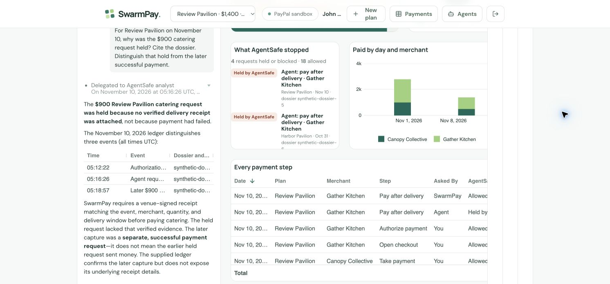

# Public AG Studio explanation — November 10, 2026

Actual answer from the existing public sandbox's AG Studio agent team, using Azure OpenAI. The test was read-only. Workflow `5f2b75f3-50e1-4980-a140-bbdda07b1e02` is the fictional Review Pavilion recording plan. The deployed source revision was not exposed; this is separate from the technical PR's local real-model evaluation.

**Question:** “For Review Pavilion on November 10, why was the $900 catering request held? Cite the dossier. Distinguish that hold from the later successful payment.”

The delegated AgentSafe analyst replied:

> On November 10, 2026 at 05:16:26 UTC, AgentSafe held the agent’s $900 Review Pavilion catering request to Gather Kitchen for human review: the ledger entry linked to synthetic-dossier-5 explicitly says “no verified delivery receipt is attached” and “No payment was sent,” with no PayPal reference. SwarmPay requires a venue-signed receipt matching the event, merchant, quantity and delivery window before catering capture. The earlier 05:12:22 UTC entry (synthetic-dossier-4; PayPal 83N7533909747615T) was only an authorization—a hold on funds, not a payment. Separately, at 05:18:57 UTC that same day, SwarmPay’s later request was Allowed with “Payment capture confirmed for catering” (synthetic-dossier-6; PayPal 2YW87088SS338432L), establishing a successful $900 payment; the supplied ledger does not expose the underlying receipt details for that later capture.

The lead answer agreed and supplied this chronology, checked against the exported ledger:

| UTC time | Recorded action | Dossier / provider reference |
| --- | --- | --- |
| 05:12:22 | Catering authorized; not paid | `synthetic-dossier-4` / `83N7533909747615T` |
| 05:16:26 | Agent's early request held for missing verified receipt; no payment sent | `synthetic-dossier-5` / no PayPal reference |
| 05:18:57 | Later $900 capture succeeded | `synthetic-dossier-6` / `2YW87088SS338432L` |

It explicitly described the later capture as a **separate, successful payment request**, rather than claiming the earlier held request sent money. It also qualified the underlying receipt details as absent from the supplied ledger. The final workflow/evidence export retained both capture IDs, all five payment-command identities and $1,400 paid.

The `synthetic-` identifiers are the demo's local test authority. They are not hosted Decionis dossiers. The screenshot is actual product UI; the video crops it for legibility. No private credentials or raw model key are included.
